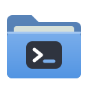

<p align="center"></p>

# Linux Explorer

A file manager for **any Linux desktop** (GNOME, KDE, XFCE, Cinnamon, ...) that looks and behaves like **Windows 11 File Explorer**, written in Rust
([egui](https://github.com/emilk/egui) + a UI-free core library).

On top of the Explorer feel it adds Dolphin's power features: split view, an embedded terminal, a filter bar,
expandable folders, batch rename, Dolphin-compatible tags and ratings, service menus, Git badges, network shares
(smb/sftp/ftp/dav), mounting drives and phones, archives as folders, and retrying with administrator rights.

Tabs in the title bar, a breadcrumb address bar, a command bar with New / Sort / View / Filter, a navigation
pane with Home, pinned folders and This PC, eight view modes, grouping, a Recycle Bin, Properties and Folder
Options. The keyboard shortcuts are Explorer's.

The full feature list, and how it was derived from a live Windows 11 Explorer, is in
[docs/FEATURES.md](docs/FEATURES.md).

## Install

You need Rust from [rustup.rs](https://rustup.rs). The repository pins toolchain 1.95, and rustup fetches it
automatically.

```bash
./packaging/install.sh             # installs to ~/.local (binary, .desktop file, icon)
./packaging/install.sh --default   # also make it the default file manager (inode/directory)
sudo ./packaging/install.sh --system
./packaging/install.sh --uninstall
```

The build needs no `-dev` packages: X11, Wayland and EGL are loaded at runtime.

**No third-party command-line tools are used.** Everything is done in-process in Rust:

| Feature | How |
|---|---|
| Archives (zip, tar, .gz, .bz2, .xz, .zst, 7z) | `zip`, `tar`, `flate2`, `bzip2`, `lzma-rs`, `ruzstd`, `sevenz-rust2` crates |
| Clipboard sharing with Nautilus/Dolphin | Owns the X11/XWayland CLIPBOARD selection itself (`x11rb`) |
| PDF thumbnails | Rendered with `hayro` (pure-Rust PDF renderer) |
| Video thumbnails | Read from the shared freedesktop thumbnail cache |
| Drives: list, mount, unmount, eject | UDisks2 D-Bus API (`zbus`) |
| Dark mode | XDG desktop portal over D-Bus, GTK/KDE config files |
| Fonts | Font folders scanned and character maps read with `ttf-parser` |
| Git status badges | `gix` (gitoxide) |
| Terminal | Built-in PTY terminal panel |
| Recycle Bin | freedesktop Trash spec (`trash` crate) |

It talks to two standard system services that every mainstream Linux desktop runs: UDisks2 (drives)
and the desktop portal (dark mode). "Retry as administrator" uses polkit's `pkexec`, the
operating system's own privilege prompt; nothing else can grant root rights.

Not done in-process:
- **RAR** archives: there is no open-source RAR decoder for Rust.
- **Connecting** to network shares: smb/sftp shares your desktop has mounted appear under Network,
  and typing their `smb://` / `sftp://` address opens them.

### Packages

```bash
cargo install cargo-deb && cargo deb -p linux-explorer                 # .deb
cargo install cargo-generate-rpm && cargo build --release -p linux-explorer \
  && cargo generate-rpm -p crates/explorer-app                          # .rpm
```

## Usage

```
linux-explorer [PATH | home | thispc | trash] [--theme light|dark] [--view details|list|tiles|content|small|medium|large|xl]
               [--system-titlebar]
```

By default the app draws its own Windows 11 title bar: tabs, plus minimize/maximize/close. Pass
`--system-titlebar` or set `LINUX_EXPLORER_SYSTEM_TITLEBAR=1` to use your desktop's decorations instead.

### Keyboard

| Keys | Action |
|---|---|
| Ctrl+T / Ctrl+W / Ctrl+Tab / Ctrl+1…9 | New tab / close tab / next tab / go to tab |
| Ctrl+N | New window |
| Alt+← / Alt+→ / Alt+↑ / Backspace | Back / Forward / Up / Back |
| Alt+D, Ctrl+L, F4 | Address bar |
| Ctrl+E, Ctrl+F, F3 | Search |
| Ctrl+I | Filter bar (Dolphin) |
| Ctrl+Shift+S | Split view (Dolphin) |
| Ctrl+&#96; | Embedded terminal panel (Dolphin) |
| Ctrl+H, Alt+. | Show hidden files |
| → / ← in Details | Expand / collapse folder inline |
| F2 (then Tab / Shift+Tab) | Rename (and move to next / previous); several selected: batch rename |
| Ctrl+Shift+N | New folder |
| Ctrl+C / Ctrl+X / Ctrl+V | Copy / Cut / Paste |
| Ctrl+Z / Ctrl+Y | Undo / Redo |
| Del, Ctrl+D / Shift+Del | Recycle Bin / delete permanently |
| Ctrl+A, Esc | Select all / select none |
| Ctrl+Shift+1…8 | Extra large … Content view |
| Ctrl+mouse wheel | Change icon size |
| Alt+P / Alt+Shift+P | Preview pane / Details pane |
| Alt+Enter | Properties |
| Ctrl+Shift+C | Copy as path |
| Ctrl+Shift+E | Expand the navigation pane to the current folder |
| Shift+F10 | Context menu |
| F5, F11, F1 | Refresh, full screen, shortcut list |

Search accepts Explorer's filters (`*.pdf`, `kind:picture`, `ext:.rs`, `size:>10MB`, `size:large`,
`modified:thisweek`) plus Dolphin-style `content:"text"`, `tag:work` and `rating:4`.

## Layout

```
crates/explorer-core   UI-free model: listing, natural sort, grouping, file operations engine
                       (copy/move/trash/delete with conflicts, pause, cancel), undo/redo, XDG trash,
                       desktop entries & mimeapps, search, zip, places, settings
crates/explorer-app    egui front end: chrome.rs (tabs, address bar, command bar, status bar),
                       nav.rs, view.rs (all views + Home / This PC), menus.rs, dialogs.rs, preview.rs
docs/FEATURES.md       complete feature specification with status
docs/re/               the UI Automation dump of Windows 11 Explorer used as the reference
packaging/             .desktop, icon, install.sh
```

## Development

```bash
cargo test --workspace              # core + UI-state tests
cargo run -p linux-explorer -- ~/Downloads
# Visual check without a person at the keyboard: render, save a PNG, exit.
cargo run -p linux-explorer -- ~ --screenshot /tmp/shot.png --size 1280x800 \
      [--test-action menu-items|menu-background|properties|options|rename|confirm-delete|address]
```

Tests that touch the Recycle Bin use a private `XDG_DATA_HOME` and never read or empty your real bin.

## Legal

This project imitates Explorer's *behaviour and layout*. It contains no Microsoft code, binaries, icons or
artwork; all icons are drawn as original vector shapes at runtime. "Windows" and "File Explorer" are
trademarks of Microsoft, used here only to describe compatibility of feel.
